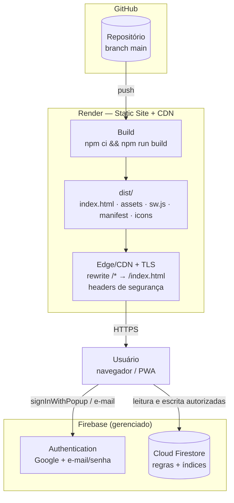

# Deploy no Render

**Versão:** 1.0
**Data:** 07/11/2026
**Responsável:** Arquiteto
**Status:** guia operacional do deploy do front-end; depende de aprovação da ADR-08.
**Escopo:** publicar a SPA React/Vite como Static Site no Render, com Firebase
Authentication e Cloud Firestore fora do Render.

---

## 1. O que vai para o Render (e o que não vai)

| Item | Vai para o Render? | Observação |
|---|---|---|
| Bundle React/Vite (`dist/`) | **Sim** | HTML, JS, CSS, ícones, manifest e service worker. |
| Configuração pública do Firebase | **Sim** | Embutida no bundle em tempo de build via `VITE_*`. Não é segredo. |
| Firebase Authentication | Não | Serviço gerenciado do Firebase. |
| Cloud Firestore | Não | Serviço gerenciado do Firebase. |
| Regras e índices do Firestore | Não | Publicados pelo Firebase CLI, em etapa separada. |
| Cloud Functions | Não | Não existem no estado atual. Se reintroduzidas, são publicadas pelo Firebase CLI, nunca pelo Render. |
| Chave Gemini / service account | **Nunca** | Segredo de servidor; não pertence ao cliente nem ao Render. |

> **Fato:** o repositório atual não possui `functions/`. O modelo vigente é Client-Only
> (`docs/arquitetura/visao-geral.md` v2.0). O Render hospeda apenas o artefato estático.

---

## 2. Topologia de implantação



**Fronteira:** o Render entrega conteúdo público. Ele **não** autentica, **não** autoriza e
**não** grava dados. A autorização continua no Firebase Authentication e nas regras do
Firestore.

---

## 3. Pré-requisitos

1. Repositório no GitHub com a branch de produção definida (recomendado: `main`).
2. Conta no Render com acesso ao repositório.
3. Projeto Firebase `complementacao-horario-aula` (conforme `.firebaserc`) com:
   - Authentication habilitado;
   - provedores **Google** e **E-mail/senha** habilitados;
   - Cloud Firestore criado;
   - regras e índices publicados (seção 8).
4. Firebase CLI autenticado na máquina do operador para publicar regras e índices.
5. Build local funcionando:

```bash
npm ci
npm run build
```

O comando deve gerar `dist/index.html`, `dist/assets/`, `dist/sw.js`,
`dist/manifest.webmanifest` e `dist/icons/`.

---

## 4. Configuração do serviço no Render

### 4.1 Pelo dashboard

| Campo | Valor |
|---|---|
| Tipo | **Static Site** |
| Repositório | GitHub do projeto |
| Branch | `main` |
| Root Directory | raiz do repositório |
| Build Command | `npm ci && npm run build` |
| Publish Directory | `dist` |
| Auto Deploy | On commit (branch `main`) |
| Pull Request Previews | **Desligado** (ver seção 7) |

### 4.2 Por Blueprint (`render.yaml`) — recomendado

O arquivo ainda **não existe** no repositório; o conteúdo abaixo é a especificação para o
agente de implementação criar na raiz. Ele não contém segredos.

```yaml
previews:
  generation: off

services:
  - type: web
    name: horario-aula
    runtime: static
    branch: main
    buildCommand: npm ci && npm run build
    staticPublishPath: ./dist
    autoDeployTrigger: commit
    envVars:
      - key: NODE_VERSION
        value: 24.22.1
      - key: SKIP_INSTALL_DEPS
        value: "true"
      - key: VITE_DATA_MODE
        value: firebase
      - key: VITE_FIREBASE_API_KEY
        sync: false
      - key: VITE_FIREBASE_AUTH_DOMAIN
        sync: false
      - key: VITE_FIREBASE_PROJECT_ID
        sync: false
      - key: VITE_FIREBASE_APP_ID
        sync: false
    routes:
      - type: rewrite
        source: /*
        destination: /index.html
    headers:
      - path: /*
        name: Cross-Origin-Opener-Policy
        value: same-origin-allow-popups
      - path: /*
        name: Cross-Origin-Embedder-Policy
        value: unsafe-none
      - path: /*
        name: X-Content-Type-Options
        value: nosniff
      - path: /*
        name: Referrer-Policy
        value: strict-origin-when-cross-origin
      - path: /*
        name: X-Frame-Options
        value: DENY
      - path: /*
        name: Permissions-Policy
        value: camera=(), microphone=(), geolocation=()
      - path: /*
        name: Strict-Transport-Security
        value: max-age=31536000; includeSubDomains
      - path: /assets/*
        name: Cache-Control
        value: public, max-age=31536000, immutable
      - path: /sw.js
        name: Cache-Control
        value: no-cache
      - path: /manifest.webmanifest
        name: Cache-Control
        value: no-cache
```

> **Atenção:** `sync: false` faz o Render solicitar o valor no dashboard. Os valores do
> Firebase são públicos, mas ficam fora do repositório para permitir ambientes distintos.

---

## 5. Variáveis de ambiente

| Variável | Obrigatória | Valor de produção | Observação |
|---|---|---|---|
| `VITE_DATA_MODE` | **Sim** | `firebase` | Se ausente ou diferente, `src/app/servicos.ts` inicia em modo demo. |
| `VITE_FIREBASE_API_KEY` | **Sim** | chave pública do app web | Não é segredo; a segurança vem das regras. |
| `VITE_FIREBASE_AUTH_DOMAIN` | **Sim** | `complementacao-horario-aula.firebaseapp.com` | **Não** usar o domínio do Render; exigiria proxy de `/__/auth/*`. |
| `VITE_FIREBASE_PROJECT_ID` | **Sim** | `complementacao-horario-aula` | Confere com `.firebaserc`. |
| `VITE_FIREBASE_APP_ID` | **Sim** | app ID do app web | Obtido no console do Firebase. |
| `NODE_VERSION` | Recomendada | `24.22.1` | Fixa a versão do build; Vite 7 exige 20.19+ / 22.12+. |
| `SKIP_INSTALL_DEPS` | Recomendada | `true` | Evita instalação automática duplicada; `npm ci` assume o controle. |

### 5.1 Regras

- Variáveis `VITE_*` são **públicas**: o Vite as injeta no bundle. Nunca coloque
  `GEMINI_API_KEY`, service account, senha ou token em variável `VITE_*`.
- A configuração é resolvida em **tempo de build**. Alterar uma variável exige **novo
  deploy**; não basta reiniciar o serviço.
- O arquivo `.env` é ignorado pelo Git. O modelo versionado é `.env.example`.

---

## 6. Roteamento, rewrite e cache

### 6.1 Roteamento

O app usa **hash routing** (`src/app/roteamento.ts`): as rotas ficam em `#/...`, e o
servidor sempre recebe `/`. Isso torna o deploy estático simples e independente de rewrite.

Ainda assim, configurar:

| Origem | Destino | Ação |
|---|---|---|
| `/*` | `/index.html` | **Rewrite** (não redirect) |

Motivos:

- cobre caminhos sem hash e uma eventual migração para history routing;
- o Render serve primeiro recursos existentes, então `sw.js`, `manifest.webmanifest`,
  `/assets/*` e `/icons/*` continuam sendo entregues diretamente;
- evita 404 em URLs antigas ou digitadas manualmente.

**Não** trocar para history routing (`BrowserRouter`) sem manter o rewrite e testar deep
links.

### 6.2 Cabeçalhos

| Cabeçalho | Valor | Motivo |
|---|---|---|
| `Cross-Origin-Opener-Policy` | `same-origin-allow-popups` | Mantém o fluxo de `signInWithPopup` do Google funcionando. |
| `Cross-Origin-Embedder-Policy` | `unsafe-none` | Compatibilidade com recursos do Firebase Auth. |
| `X-Content-Type-Options` | `nosniff` | Impede sniffing de MIME. |
| `Referrer-Policy` | `strict-origin-when-cross-origin` | Não vaza caminho completo para terceiros. |
| `X-Frame-Options` | `DENY` | Impede incorporação da aplicação em iframe. |
| `Permissions-Policy` | `camera=(), microphone=(), geolocation=()` | Reduz superfície de APIs do navegador. |
| `Strict-Transport-Security` | `max-age=31536000; includeSubDomains` | Força HTTPS após o primeiro acesso. |
| `Cache-Control` em `/assets/*` | `public, max-age=31536000, immutable` | Assets têm hash no nome; cache longo é seguro. |
| `Cache-Control` em `/sw.js` | `no-cache` | O navegador precisa revalidar o service worker a cada visita. |
| `Cache-Control` em `/manifest.webmanifest` | `no-cache` | Evita manifesto desatualizado. |

> **CSP:** não será aplicada na primeira publicação. Uma política restritiva precisa liberar
> `firebaseapp.com`, o WebChannel do Firestore e o popup do Google; habilitar sem teste
> quebra o login. Fica como evolução registrada em `RISCO-27`/`RISCO-30`.

### 6.3 Verificação de cache

O Render invalida o CDN a cada deploy, mas o `sw.js` e o HTML precisam ser conferidos.
Após o deploy:

```bash
curl.exe -I https://SEU-SERVICO.onrender.com/
curl.exe -I https://SEU-SERVICO.onrender.com/sw.js
curl.exe -I https://SEU-SERVICO.onrender.com/manifest.webmanifest
```

Verifique `cache-control`, `cross-origin-opener-policy` e `strict-transport-security`.

---

## 7. Firebase Authentication

### 7.1 Domínios autorizados

No console do Firebase: **Authentication → Settings → Authorized domains**.

Adicionar:

| Domínio | Quando |
|---|---|
| `SEU-SERVICO.onrender.com` | Sempre (subdomínio exibido pelo Render). |
| Domínio customizado | Se houver domínio próprio apontado para o Render. |

Sem isso, o login Google e o cadastro por e-mail falham com
`auth/unauthorized-domain`. O app já traduz esse código em
`src/services/firebase/autenticacaoFirebase.ts`.

### 7.2 `authDomain`

Manter `VITE_FIREBASE_AUTH_DOMAIN=<projeto>.firebaseapp.com`. O fluxo usado é
`signInWithPopup`; o domínio do Render é a origem da aplicação, não o domínio do helper de
autenticação. Usar o domínio do Render como `authDomain` exigiria proxy transparente de
`/__/auth/*`, que um Static Site não oferece.

### 7.3 Previews de PR

Cada preview do Render recebe um subdomínio novo. O Firebase **não aceita curinga** em
domínios autorizados. Portanto:

- manter previews **desligados** no serviço de produção;
- se um preview for necessário, autorizar manualmente o domínio dele e tratar como ambiente
  separado;
- nunca promover um preview para produção sem revisar as variáveis `VITE_*`.

### 7.4 Primeiro gestor

O script `scripts/bootstrap-gestor.ts` não grava no Firestore: as regras bloqueiam a
criação de `users/{uid}` com papel administrativo pelo cliente. O primeiro gestor exige
operação administrativa (Admin SDK/console) e deve ser concluído **antes** de liberar a URL
para os usuários. Esse passo não faz parte do build do Render.

---

## 8. Firestore: regras e índices

O build do Render **não** publica regras nem índices. A ordem de release é:

1. publicar índices;
2. aguardar os índices ficarem com estado **Enabled** no console;
3. publicar regras;
4. publicar o front-end no Render.

```bash
firebase login
firebase use complementacao-horario-aula
firebase deploy --only firestore:indexes
# aguardar a construção dos índices no console
firebase deploy --only firestore:rules
```

Ou, depois de os índices estarem prontos:

```bash
firebase deploy --only firestore:rules,firestore:indexes
```

**Por que separar:** um deploy de front-end que dependa de índice ainda não construído
falha em consultas; uma regra publicada antes do front-end pode bloquear operações que a
versão antiga fazia. O release é um conjunto, mas o Render é apenas uma das etapas.

---

## 9. PWA e service worker

| Item | Situação |
|---|---|
| Arquivo | `public/sw.js`, copiado para `dist/sw.js` pelo Vite. |
| Escopo | Raiz (`/`), pois o arquivo está na raiz publicada. |
| Cache | Somente shell estático (`./`, `index.html`, `manifest`, `favicon`); nenhum dado do Firestore. |
| Navegação | Rede primeiro, com fallback para o shell em caso de indisponibilidade. |
| Assets | Cache primeiro para `/assets/*` e `/icons/*`. |
| Atualização | Detectada por `src/app/useAtualizacaoPwa.ts` quando o `sw.js` muda. |

**Limitação conhecida:** o conteúdo de `sw.js` é estático e não muda a cada build. Se o
arquivo não for versionado, o navegador pode não disparar `updatefound`, e o aviso de
“atualização disponível” não aparece. A navegação continua sendo rede-primeiro, então um
reload normal pega o novo `index.html` e os novos assets com hash.

**Recomendação (implementação futura):** gerar `dist/sw.js` no build com um identificador
de versão (commit SHA) no `CACHE_NAME`, mantendo o arquivo fonte em `public/sw.js`. Isso
torna a atualização detectável e o cache antigo descartável. Enquanto não for feito, o
smoke test deve incluir um reload após deploy.

---

## 10. CI/CD, rollback e operação

| Item | Decisão |
|---|---|
| Gatilho | Push na branch `main`. |
| Build | Atômico; falha de build não substitui a versão publicada. |
| Deploy | Zero-downtime; CDN invalidado ao final. |
| Rollback | Dashboard do Render → histórico de deploys → rollback para o deploy anterior; ou `git revert` + push. |
| Variáveis | Rollback de deploy **não** reverte variáveis de ambiente; conferir no dashboard. |
| Build filter | Opcional: ignorar mudanças que não afetam o front-end (`docs/**`, `firestore.rules`, `firestore.indexes.json`). |
| Observabilidade | Logs de build no Render; erros de runtime aparecem no console do navegador e no Firebase. |
| Firestore | Regras/índices têm release próprio (seção 8). |

### 10.1 Filtro de build sugerido

```yaml
buildFilter:
  paths:
    - src/**/*
    - public/**/*
    - index.html
    - package.json
    - package-lock.json
    - vite.config.ts
    - tsconfig.json
    - tsconfig.app.json
    - tsconfig.node.json
```

Mudanças em `firestore.rules` ou `firestore.indexes.json` não exigem rebuild do front-end,
mas exigem o deploy do Firebase.

---

## 11. Checklist de go-live

- [ ] `npm ci && npm run build` passa localmente com as variáveis de produção.
- [ ] `dist/index.html`, `dist/assets/`, `dist/sw.js`, `dist/manifest.webmanifest` e
      `dist/icons/` existem.
- [ ] Static Site criado com `npm ci && npm run build` e publish `dist`.
- [ ] `VITE_DATA_MODE=firebase` e as quatro variáveis do Firebase configuradas.
- [ ] `NODE_VERSION` fixada e `SKIP_INSTALL_DEPS=true`.
- [ ] Nenhum segredo em variável `VITE_*` (revisar `.env.example` e o bundle).
- [ ] Domínio `*.onrender.com` e domínio customizado autorizados no Firebase Auth.
- [ ] Provedores Google e e-mail/senha habilitados.
- [ ] Índices do Firestore publicados e **Enabled**.
- [ ] Regras do Firestore publicadas.
- [ ] Login Google e login por e-mail funcionam na URL publicada.
- [ ] Leitura de turmas/professores/horários funciona com usuário real.
- [ ] Operação administrativa funciona com `admin`/`gestor`.
- [ ] PWA instalável; `sw.js` registrado; atualização testada após novo deploy.
- [ ] `curl.exe -I` confirma COOP, HSTS, `nosniff` e cache de assets.
- [ ] Rewrite responde com a SPA em um caminho profundo (ex.: `/teste`).
- [ ] Rollback testado no dashboard.
- [ ] LAC-20 decidida antes de divulgar a URL publicamente.

---

## 12. Smoke test manual

1. Abrir a URL publicada em janela anônima.
2. Confirmar que a aplicação **não** mostra o aviso de modo demonstração.
3. Entrar com Google e, em outra janela, com e-mail/senha.
4. Consultar uma turma e um professor; conferir horários.
5. Entrar com perfil administrativo e abrir cadastros, aulas e histórico.
6. Instalar o PWA e abrir offline; confirmar que o shell carrega.
7. Fazer um deploy de teste (commit sem mudança funcional) e confirmar que a versão nova
   aparece após reload.
8. Executar os `curl.exe -I` da seção 6.3.

---

## 13. Troubleshooting

| Sintoma | Causa provável | Ação |
|---|---|---|
| App abre em modo demonstração | `VITE_DATA_MODE` ausente ou configuração Firebase incompleta no build. | Conferir env no Render e refazer o deploy. |
| `auth/unauthorized-domain` | Domínio do Render não autorizado. | Adicionar em Authentication → Settings → Authorized domains. |
| `auth/invalid-api-key` | Variável de API key errada ou de outro projeto. | Conferir `VITE_FIREBASE_API_KEY` e `VITE_FIREBASE_PROJECT_ID`. |
| Popup do Google não conclui | COOP ausente, popup bloqueado ou domínio não autorizado. | Conferir header COOP, permitir popup e autorizar domínio. |
| 404 ao abrir caminho profundo | Rewrite não configurado. | Criar `/* → /index.html` com ação Rewrite. |
| Versão antiga após deploy | Cache do service worker/CDN. | Conferir `Cache-Control` de `sw.js`; hard reload; versionar `CACHE_NAME`. |
| Página em branco | Build sem `dist/index.html` ou publish directory errado. | Conferir logs de build e `staticPublishPath`. |
| `permission-denied` no Firestore | Regras não publicadas ou perfil sem papel válido. | Publicar regras; conferir `users/{uid}.role`. |
| Ícones/manifest 404 | Arquivos não copiados para `dist` ou publish errado. | Conferir `public/` e `dist/`. |
| Build falha no `tsc` | Erro de tipo que não aparecia no dev. | Rodar `npm run build` localmente antes do push. |

---

## 14. Custos e limites

| Item | Observação |
|---|---|
| Static Site | Plano gratuito do Render; sem cold start. |
| Banda | Consome a franquia do workspace; assets com hash e cache imutável reduzem consumo. |
| Pipeline minutes | Consome a franquia do workspace a cada build. |
| TLS/CDN | Incluídos no Static Site. |
| Domínios | Quantidade incluída depende do plano do workspace. |
| Firebase | Authentication e Firestore têm cotas e custos próprios, fora do Render. |

Confirmar os valores atuais no dashboard de billing do Render antes de divulgar a URL.

---

## 15. Riscos e lacunas

| ID | Item | Situação |
|---|---|---|
| RISCO-24 | Produção em modo demo por env ausente. | Mitigado por checklist; idealmente falha de build. |
| RISCO-25 | Login quebrado por domínio não autorizado. | Mitigado pela seção 7. |
| RISCO-26 | PWA/CDN com versão antiga. | Mitigado por `no-cache` e smoke test; versionamento do SW recomendado. |
| RISCO-27 | Segredo em `VITE_*`. | Mitigado por revisão e `.env.example`. |
| RISCO-28 | Regras/índices dessincronizados. | Mitigado pela ordem de release. |
| RISCO-29 | Limites de banda/build. | Monitorar dashboard. |
| RISCO-30 | Popup Google/COOP. | Mitigado por header e teste. |
| RISCO-31 | Acesso público amplo (LAC-20). | **Aberto**; decisão de negócio pendente. |
| RISCO-32 | Modelo Client-Only sem autoridade server-side. | **Herdado**; ver `guia-refatoracao-client-side.md`. |
| RISCO-23 | Regras sem teste automatizado (JDK 21). | **Aberto**; revisão manual antes de publicar. |

---

## 16. Próximos passos

1. Aprovar a ADR-08.
2. O agente de implementação cria `render.yaml` (seção 4.2) ou configura o Static Site no
   dashboard.
3. Autorizar os domínios no Firebase Authentication.
4. Publicar índices e regras do Firestore.
5. Executar o checklist e o smoke test.
6. Decidir LAC-20 antes de divulgar a URL.
7. Evoluir o build para falhar quando `VITE_DATA_MODE=firebase` e a configuração estiver
   incompleta, e para versionar o `CACHE_NAME` do service worker.
