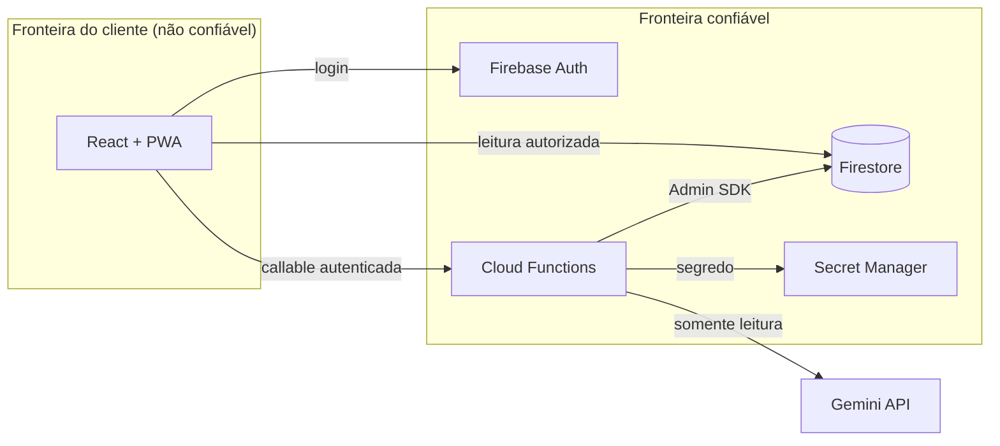
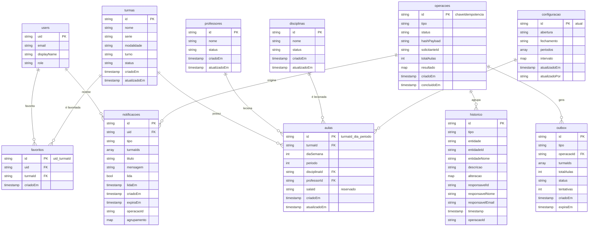
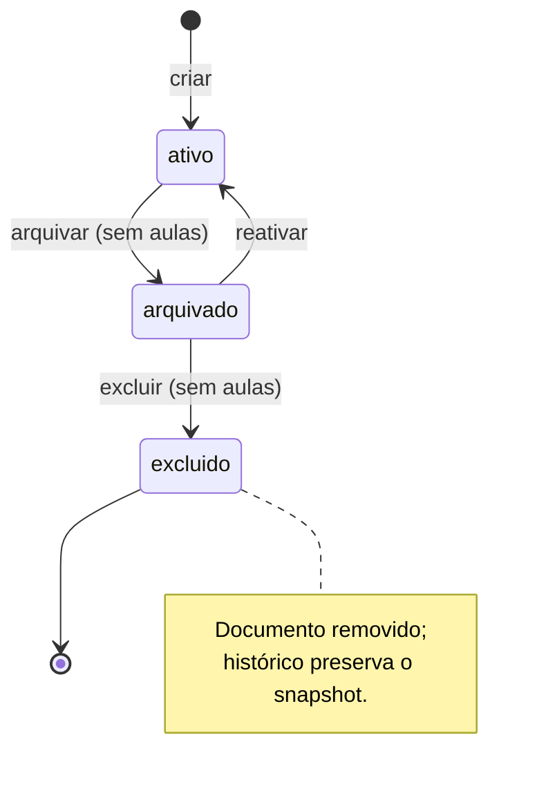
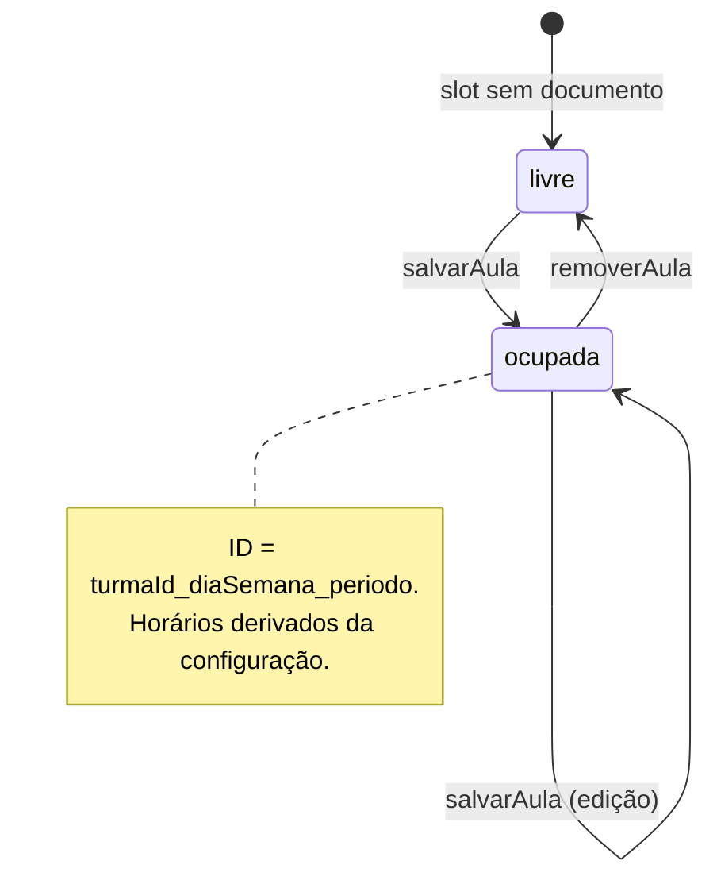
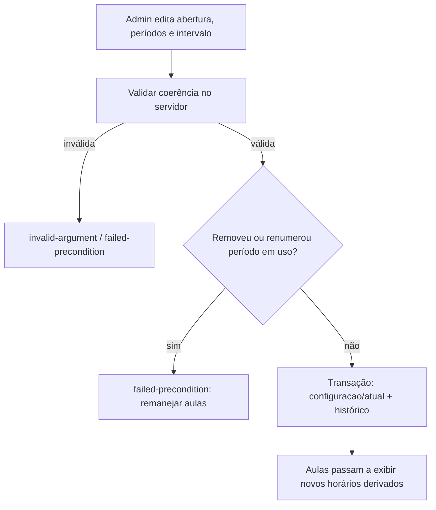

# Diagramas

**Versão:** 1.0
**Data:** 03/11/2026

> Os diagramas de sequência dos fluxos `FL-01` (edição individual) e `FL-02` (edição em
> massa + notificação) estão em `docs/arquitetura/integracoes.md` para ficarem próximos
> dos contratos.

---

## 1. Contexto e fronteiras de confiança

---

## 2. Modelo de entidades

---

## 3. Ciclo de vida de cadastro

---

## 4. Ciclo de vida da aula

---

## 5. Fluxo de configuração de horários

