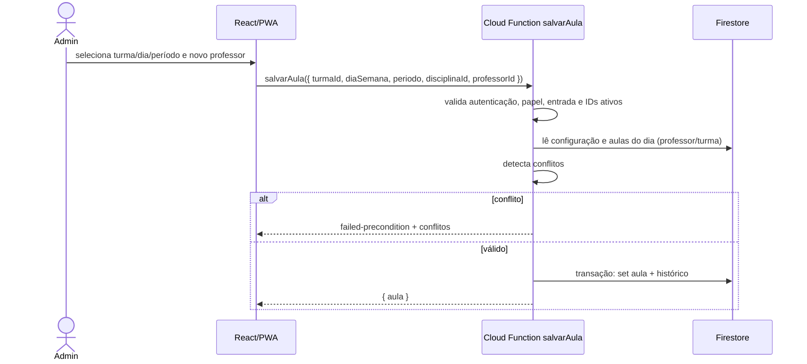
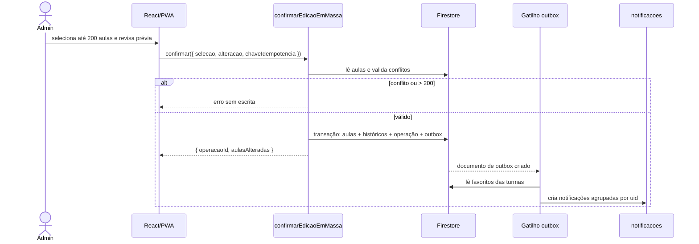

# Integrações e contratos

**Versão:** 1.0
**Data:** 03/11/2026
**Status:** canônico para o Back-End e o Front-End.
**Região padrão:** `southamerica-east1` (A-02, pendente de confirmação antes do deploy).

---

## 1. Convenções comuns

| Item | Regra |
|---|---|
| Tipo | Cloud Functions v2 `onCall`, autenticadas. |
| Autorização | Lida do perfil `users/{uid}.role` no servidor; nunca do payload. |
| Papéis administrativos | `admin` e `gestor` para catálogo, aulas, configuração, histórico. |
| Validação | Entrada validada no servidor; erros com código estável + `correlacao`. |
| Datas | Payloads usam ISO 8601; persistência usa `Timestamp`. |
| Idempotência | Obrigatória em edição em massa e recomendada no seed. |
| Contratos | Tipos espelhados em `src/types/contratos.ts` e `functions/src/contracts/` até existir pacote compartilhado. |

### 1.1 Formato de erro

```ts
interface ErroCallable {
  code:
    | 'unauthenticated'
    | 'permission-denied'
    | 'invalid-argument'
    | 'not-found'
    | 'already-exists'
    | 'failed-precondition'
    | 'aborted'
    | 'resource-exhausted'
    | 'unavailable'
    | 'internal';
  message: string;          // segura para o usuário
  details?: {
    correlacao: string;
    campos?: Array<{ campo: string; mensagem: string }>;
    conflitos?: ConflitoHorario[];
    maximo?: number;
    aulasAtivas?: number;
  };
}
```

---

## 2. `garantirPerfil` (existente)

**Requisitos:** RF01, RF02, RF03.
**Contrato atual:** `docs/backend/contratos.md`.
**Mudança nesta decisão:** nenhuma. O front-end deve chamá-la logo após o login Google,
antes de ler `users/{uid}`.

---

## 3. Catálogo: professores, disciplinas e turmas

### 3.1 `salvarCadastro`

**Requisitos:** RF04, RF05, RF06, RF48–RF50.
**Autorização:** `admin` ou `gestor`.

```ts
type EntradaSalvarCadastro =
  | { tipo: 'professor'; id?: string; nome: string }
  | { tipo: 'disciplina'; id?: string; nome: string }
  | {
      tipo: 'turma';
      id?: string;
      nome: string;
      serie: string;
      modalidade: 'ensino-medio' | 'tecnico';
      turno: 'manha';
    };
```

**Comportamento**

1. Valida `tipo`, campos obrigatórios, tamanhos e enums.
2. `id` ausente → cria com auto-ID. `id` presente → exige documento existente.
3. `status` não é aceito aqui; use `alterarStatusCadastro`.
4. Em transação: grava o documento e o histórico (`tipo: 'cadastro'`,
   `entidade: 'professores'|'disciplinas'|'turmas'`, `alteracao.antes/depois`).
5. Retorna `{ id, cadastro }`.

**Erros:** `invalid-argument`, `not-found` (quando `id` é informado e não existe),
`permission-denied`.

> O seed usa IDs determinísticos e grava diretamente com Admin SDK; `salvarCadastro` usa
> auto-ID em criação normal. Não há criação com ID escolhido pelo cliente.

### 3.2 `alterarStatusCadastro`

**Requisitos:** RF48, RF49, RF50.
**Autorização:** `admin` ou `gestor`.

```ts
interface EntradaAlterarStatus {
  tipo: 'professor' | 'disciplina' | 'turma';
  id: string;
  status: 'ativo' | 'arquivado';
}
```

**Regras**

- Arquivar exige que não exista aula referenciando o cadastro. Caso exista, retorna
  `failed-precondition` com `aulasAtivas` e a lista de aulas (até 20) para o admin
  remanejar.
- Reativar não exige dependência; apenas altera `status` e `atualizadoEm`.
- Histórico obrigatório na mesma transação.
- Retorna `{ id, status }`.

> A exigência de “sem aulas” para arquivar é uma decisão de integridade (ADR-06). Ela evita
> grades apontando para cadastros fora das listas ativas. Se Requisitos preferirem arquivar
> com aulas, a decisão deve ser revista.

### 3.3 `excluirCadastro`

**Requisitos:** RF51, RF52, RF53.
**Autorização:** `admin` ou `gestor`.

```ts
interface EntradaExcluirCadastro {
  tipo: 'professor' | 'disciplina' | 'turma';
  id: string;
}
```

**Regras**

1. Exige `status === 'arquivado'`; senão `failed-precondition`.
2. Exige zero aulas referenciando o cadastro; senão `failed-precondition`.
3. Em transação: lê o documento, grava histórico com snapshot completo em
   `alteracao.antes` e `depois: {}`, e exclui o documento.
4. Se `tipo === 'turma'`, remove favoritos da turma. Até 500 favoritos na mesma transação;
   acima disso, agenda limpeza via outbox e ainda conclui a exclusão.
5. Retorna `{ id, excluido: true }`.

**Nunca** exclui histórico. `entidadeNome` e `alteracao.antes` preservam os dados
descritivos (RF53).

---

## 4. Aulas

### 4.1 `salvarAula`

**Requisitos:** RF07, RF13, RF14, RF15, RF16, RF33, RF41, RF42.
**Autorização:** `admin` ou `gestor`.

```ts
interface EntradaSalvarAula {
  turmaId: string;
  diaSemana: 1 | 2 | 3 | 4 | 5;
  periodo: number;          // precisa existir em configuracao/atual.periodos
  disciplinaId: string;
  professorId: string;
  salaId?: string;          // rejeitado enquanto LAC-23/LAC-24 não aprovadas
}
```

**Comportamento**

1. Valida `diaSemana` 1–5, `periodo` existente e `turma`/`disciplina`/`professor`
   existentes e ativos.
2. Calcula `inicio`/`fim` pela configuração e detecta conflitos de professor e turma
   (e sala, se habilitada) contra as aulas do mesmo dia.
3. Usa o ID `${turmaId}_${diaSemana}_${periodo}`.
4. Em transação: `set` da aula + histórico (`tipo: 'aula'`).
5. Se a aula não existir, registra criação (`antes: {}`). Se existir e nada mudou, retorna
   sem gravar histórico.
6. Retorna `{ aula }` com `id`, campos persistidos e `inicio`/`fim` derivados.

**Erros:** `invalid-argument`, `not-found`, `failed-precondition` (conflito),
`permission-denied`.

### 4.2 `removerAula`

**Requisitos:** RF07, RF13.
**Autorização:** `admin` ou `gestor`.

```ts
interface EntradaRemoverAula {
  turmaId: string;
  diaSemana: 1 | 2 | 3 | 4 | 5;
  periodo: number;
}
```

- Remove o documento do slot e grava histórico com snapshot.
- Se o slot já estiver vazio, retorna `{ removida: true, jaVazia: true }` sem histórico.
- Retorna `{ removida: true }`.

### 4.3 Leitura de aulas

Leitura direta no Firestore, autenticada:

```ts
// Grade de uma turma
query(
  collection(db, 'aulas'),
  where('turmaId', '==', turmaId),
  orderBy('diaSemana'),
  orderBy('periodo'),
);

// Grade de um professor
query(
  collection(db, 'aulas'),
  where('professorId', '==', professorId),
  orderBy('diaSemana'),
  orderBy('periodo'),
);
```

O cliente converte `Timestamp` e deriva `inicio`/`fim` de `configuracao/atual`. Nenhum
componente de UI acessa o Firestore diretamente; usa o serviço.

---

## 5. Configuração

### 5.1 `salvarConfiguracao`

**Requisitos:** RF36–RF40.
**Autorização:** `admin` ou `gestor`.

```ts
interface EntradaSalvarConfiguracao {
  abertura: string;         // HH:MM
  fechamento: string;       // HH:MM
  periodos: Array<{ numero: number; inicio: string; fim: string }>;
  intervalo: { inicio: string; fim: string } | null;
}
```

**Comportamento**

1. Reutiliza `validarConfiguracaoHorarios` (já implementado).
2. Verifica se algum período removido/renumerado possui aulas; se sim,
   `failed-precondition` com a lista de períodos em uso.
3. Em transação: grava `configuracao/atual` + histórico (`tipo: 'configuracao'`).
4. Não reescreve aulas; os horários são derivados (ADR-02).
5. Retorna a configuração salva.

**Impacto:** a prévia de impacto é responsabilidade da UI; o servidor informa quantas
aulas serão afetadas na resposta (`{ aulasAfetadas }`).

---

## 6. Edição em massa

### 6.1 `previaEdicaoEmMassa`

**Requisitos:** RF23–RF29, RF34, RF35.
**Autorização:** `admin` ou `gestor`.
**Não escreve nada.**

```ts
interface SelecaoAulas {
  aulaIds: string[];        // máximo 200, únicos
}

type AlteracaoMassa =
  | { professorId: string; disciplinaId?: undefined }
  | { disciplinaId: string; professorId?: undefined }
  | { professorId: string; disciplinaId: string };
```

**Entrada**

```ts
interface EntradaPreviaMassa {
  selecao: SelecaoAulas;
  alteracao: AlteracaoMassa;
}
```

**Comportamento**

1. Rejeita > 200 IDs com `resource-exhausted` e `details.maximo = 200`.
2. Lê as aulas e valida existência, turma/disciplina/professor ativos.
3. Calcula o estado final e detecta conflitos de professor/turma (e sala, se habilitada).
4. Retorna:

```ts
interface RespostaPreviaMassa {
  total: number;
  alteracoes: Array<{
    aulaId: string;
    turmaId: string;
    diaSemana: number;
    periodo: number;
    antes: { disciplinaId: string; professorId: string };
    depois: { disciplinaId: string; professorId: string };
  }>;
  conflitos: ConflitoHorario[];
}
```

### 6.2 `confirmarEdicaoEmMassa`

**Requisitos:** RF26–RF30, RF34, RF35, RF47.
**Autorização:** `admin` ou `gestor`.

```ts
interface EntradaConfirmarMassa extends EntradaPreviaMassa {
  chaveIdempotencia: string;  // UUID v4
}
```

**Comportamento**

1. Revalida tudo no servidor; nunca confia na prévia do cliente.
2. Aplica no máximo 200 aulas em uma única transação:
   - 200 aulas;
   - 200 históricos com ID `{operacaoId}_{aulaId}`;
   - 1 documento `operacoes/{chaveIdempotencia}`;
   - 1 documento `outbox/{evento}`.
3. Se houver conflito, nenhuma escrita e `failed-precondition`.
4. Se a chave já existir com o mesmo `hashPayload`, retorna o resultado anterior. Hash
   diferente → `already-exists`.
5. Notificação é criada depois do commit pelo gatilho do outbox.
6. Retorna:

```ts
interface RespostaConfirmarMassa {
  operacaoId: string;
  aulasAlteradas: number;
  notificacoesAgendadas: boolean;
}
```

**Garantia:** tudo-ou-nada; não existe aplicação parcial. Acima de 200, o admin divide a
operação.

---

## 7. Histórico

### 7.1 `listarHistorico`

**Requisitos:** RF21.
**Autorização:** `admin` ou `gestor`. `professor` e `aluno` recebem `permission-denied`.

```ts
interface EntradaListarHistorico {
  tipo?: 'aula' | 'configuracao' | 'cadastro' | 'permissao' | 'sistema';
  entidade?: string;
  entidadeId?: string;
  responsavelId?: string;
  de?: string;              // ISO 8601
  ate?: string;             // ISO 8601
  limite?: number;          // padrão 50, máximo 100
  cursor?: string;          // opaco, retornado pela chamada anterior
}
```

**Resposta**

```ts
interface RespostaListarHistorico {
  itens: RegistroHistorico[];
  proximoCursor: string | null;
}
```

**Regras**

- Ordenação `timestamp DESC`.
- Cursor opaco (base64 de `timestamp` + ID do documento); não expor caminho interno.
- Filtros combinados suportados: `entidade` + `entidadeId`; `tipo`; `responsavelId`;
  intervalo `de`/`ate`.
- Leitura sempre via Admin SDK; o cliente nunca lê `historico`.

---

## 8. Notificações e favoritos (leitura/escrita direta controlada)

### 8.1 Notificações

**Requisitos:** RF43–RF47.

**Leitura**

```ts
query(
  collection(db, 'notificacoes'),
  where('uid', '==', usuario.uid),
  orderBy('criadoEm', 'desc'),
  limit(50),
);
```

**Marcar como lida** (update direto, restrito por regra):

```ts
update(doc(db, 'notificacoes', id), {
  lida: true,
  lidaEm: serverTimestamp(),
});
```

**Regras:** o `uid` do documento precisa ser o autenticado; somente `lida` e `lidaEm` podem
mudar; `lida` e `lidaEm` devem ser coerentes. Criação e exclusão são negadas ao cliente.

### 8.2 Favoritos

**Requisitos:** RF09.

```ts
// favoritar
setDoc(doc(db, 'favoritos', `${uid}_${turmaId}`), {
  uid,
  turmaId,
  criadoEm: serverTimestamp(),
});

// desfavoritar
deleteDoc(doc(db, 'favoritos', `${uid}_${turmaId}`));

// listar
query(
  collection(db, 'favoritos'),
  where('uid', '==', uid),
  orderBy('criadoEm', 'desc'),
);
```

**Regras:** doc ID precisa ser `{uid}_{turmaId}`; `uid` precisa ser o autenticado; a turma
precisa existir; update negado; leitura/exclusão somente do próprio `uid`.

### 8.3 Fan-out de notificações

1. `confirmarEdicaoEmMassa` grava `outbox` na transação.
2. Gatilho `onDocumentCreated` em `outbox` lê os favoritos das `turmaIds` afetadas.
3. Agrupa por `uid`: um único documento `notificacoes/{operacaoId}_{uid}` por usuário,
   mesmo que ele tenha favoritado várias turmas afetadas.
4. Processa em lotes; IDs determinísticos tornam retries seguros.
5. Atualiza `outbox.status` para `concluido` ou `falhou` com `tentativas`.

**Limite:** acima de 500 destinatários, processar em múltiplos lotes; nunca ultrapassar
500 escritas por commit. Se o volume crescer, migrar para fan-out por turma com múltiplos
eventos de outbox.

---

## 9. Assistente Gemini

### 9.1 `perguntarAoAssistente`

**Requisito:** RF10.
**Autorização:** qualquer usuário autenticado.
**Modelo:** `google/gemini-3.1-flash-lite` (D-01).
**Segredo:** `GEMINI_API_KEY` no Secret Manager; nunca no cliente.

```ts
interface EntradaPerguntar {
  pergunta: string;         // 1–500 caracteres
}

interface RespostaPerguntar {
  resposta: string;         // até 2000 caracteres
  fontes?: Array<{
    tipo: 'turma' | 'professor' | 'disciplina' | 'aula';
    id: string;
    nome: string;
  }>;
}
```

### 9.2 Ferramentas allowlist (somente leitura)

| Ferramenta | Entrada | Saída |
|---|---|---|
| `consultarTurmas` | `{ termo?: string }` | Lista de turmas ativas (id, nome, série, modalidade). |
| `consultarTurma` | `{ turmaId?: string; nome?: string }` | Turma + grade semanal (dia, período, início, fim, disciplina, professor). |
| `consultarProfessor` | `{ professorId?: string; nome?: string }` | Professor + aulas da semana (turma, dia, período, início, fim, disciplina). |
| `consultarDisciplina` | `{ disciplinaId?: string; nome?: string }` | Disciplina + aulas/turmas relacionadas. |
| `consultarHorario` | `{ turmaId?: string; professorId?: string; diaSemana?: 1..5 }` | Aulas filtradas, até 100 linhas. |

**Proibido:** qualquer ferramenta de escrita, acesso a `users`, `historico`,
`notificacoes`, `operacoes`, `outbox`, `assistente_uso`, ou consulta livre por caminho do
Firestore. O modelo nunca recebe credenciais.

### 9.3 Limites

| Item | Limite |
|---|---|
| Pergunta | 500 caracteres |
| Resposta | 2000 caracteres |
| Chamadas de ferramenta por pergunta | 5 |
| Tempo máximo | 20 s |
| Cota por usuário | 30 perguntas/dia e 5/minuto |
| Cota global | 1000 perguntas/dia (configurável por ambiente) |
| Linhas por ferramenta | 100 |

Acima da cota: `resource-exhausted`. Gemini indisponível: `unavailable`, sem inventar
resposta.

### 9.4 Logs e privacidade

- Registrar apenas metadados: `correlacao`, hash do `uid`, duração, tokens de entrada/saída,
  ferramentas usadas, status.
- **Não** persistir a pergunta nem a resposta em texto claro na v1.
- Retenção dos metadados: 30 dias.
- O prompt de sistema instrui: responder somente com dados das ferramentas; se não houver
  dado, dizer que não encontrou; não inventar horários, professores ou disciplinas.
- Fuso para “hoje/amanhã”: `America/Sao_Paulo` (LAC-21 pendente de confirmação).

---

## 10. Seed das 420 aulas

**Script:** `functions/src/scripts/seed-horarios.ts` (executado por humano com ADC).
**Não é callable.**

```text
node lib/scripts/seed-horarios.js --confirmar
node lib/scripts/seed-horarios.js --dry-run
node lib/scripts/seed-horarios.js --confirmar --sobrescrever
```

**Entrada:** `functions/src/scripts/dados/horarios-2026.json`.
**Saída:** relatório com criados, ignorados, atualizados e conflitos.

**Validações obrigatórias**

1. 14 turmas, 5 dias, 6 aulas/dia, 420 IDs únicos.
2. Toda referência existe.
3. `diaSemana` 1–5 e `periodo` 1–6.
4. Nenhum conflito de professor/turma; se houver, falhar com a lista.
5. Lotes ≤ 500 operações.
6. Um único histórico `tipo: 'sistema'` ao final.

---

## 11. Matriz de erros por contrato

| Contrato | `invalid-argument` | `permission-denied` | `failed-precondition` | `resource-exhausted` | `already-exists` |
|---|---|---|---|---|---|
| `salvarCadastro` | campos/enums | não admin | — | — | — |
| `alterarStatusCadastro` | status/tipo | não admin | aulas ativas ao arquivar | — | — |
| `excluirCadastro` | tipo/id | não admin | não arquivado ou aulas ativas | — | — |
| `salvarAula` | dia/período/IDs | não admin | conflito | — | — |
| `removerAula` | dia/período | não admin | — | — | — |
| `salvarConfiguracao` | horários | não admin | período em uso | — | — |
| `previaEdicaoEmMassa` | seleção/alteração | não admin | conflito | > 200 aulas | — |
| `confirmarEdicaoEmMassa` | seleção/alteração | não admin | conflito | > 200 aulas | chave com hash diferente |
| `listarHistorico` | filtros | não admin/gestor | — | — | — |
| `perguntarAoAssistente` | pergunta vazia/longa | sem login | — | cota | — |

---

## 12. Sequências

### FL-01 — edição individual de aula



### FL-02 — edição em massa e notificação


