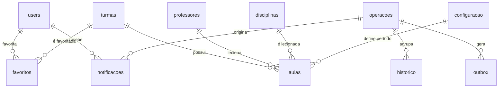

# Modelo de dados canônico — Cloud Firestore

**Versão:** 1.0
**Data:** 03/11/2026
**Status:** canônico. Substitui o schema de `Plano/arquitetura/modelo-dados-firestore.md`.
**Decisões:** ADR-01 (LAC-08), ADR-02 (LAC-02), ADR-03 (LAC-05), ADR-04 (LAC-10/LAC-11),
ADR-05 (LAC-13), ADR-06 (LAC-16).

---

## 1. Resposta ao LAC-08: Opção B

**A nomenclatura canônica é a do front-end (Opção B), com uma correção de consistência:
as coleções também passam a usar português.**

| Entidade | Antes (arquitetura) | Antes (front-end) | Canonico |
|---|---|---|---|
| Professor | `professors`: `id`, `name`, `status` | `professors`: `id`, `nome`, `status`, `criadoEm` | `professores`: doc ID, `nome`, `status`, `criadoEm`, `atualizadoEm` |
| Disciplina | `subjects`: `id`, `name`, `status` | `disciplinas`: `id`, `nome`, `status`, `criadoEm` | `disciplinas`: doc ID, `nome`, `status`, `criadoEm`, `atualizadoEm` |
| Turma | `turmas`: `id`, `name`, `status` | `turmas`: `id`, `nome`, `serie`, `modalidade`, `status`, `criadoEm` | `turmas`: doc ID, `nome`, `serie`, `modalidade`, `turno`, `status`, `criadoEm`, `atualizadoEm` |
| Aula | `horarios`: `turmaID`, `disciplinaID`, `professorID`, `salaID`, `diaSemana`, `periodo` | `horarios`: `turmaId`, `disciplinaId`, `professorId`, `diaSemana`, `periodo`, `atualizadoEm` | `aulas`: doc ID composto, `turmaId`, `diaSemana`, `periodo`, `disciplinaId`, `professorId`, `salaId?`, `criadoEm`, `atualizadoEm` |
| Histórico | `historico`: `entidade`, `entidadeID`, `alteracao{antes,depois}`, `responsavelID`, `timestamp` | `tipo`, `entidadeId`, `descricao`, `alteracao`, `responsavelId`, `responsavelNome`, `timestamp` | `historico`: `tipo`, `entidade`, `entidadeId`, `entidadeNome`, `descricao`, `alteracao`, `responsavelId`, `responsavelNome`, `responsavelEmail`, `timestamp`, `operacaoId?`, `correlacao?` |
| Notificação | não definida | `uid`, `turmaId`, `titulo`, `mensagem`, `lida`, `criadoEm`, `agrupamento` | `notificacoes`: `uid`, `tipo`, `turmaIds`, `titulo`, `mensagem`, `lida`, `lidaEm`, `criadoEm`, `expiraEm`, `operacaoId`, `agrupamento` |
| Favorito | não definido | `uid`, `turmaId`, `criadoEm` | `favoritos`: doc ID `{uid}_{turmaId}`, `uid`, `turmaId`, `criadoEm` |

### 1.1 Por que B

1. O cliente lê o Firestore diretamente para catálogo, aulas e configuração. Renomear
   campos no cliente exigiria adaptadores em toda leitura e em todos os filtros.
2. A arquitetura anterior era um rascunho sem dados em produção; o front-end já possui
   contratos estáveis e tipos de domínio.
3. A Opção C obrigaria todas as leituras a passar por Cloud Functions, aumentando custo,
   latência e perda de experiência offline do PWA.

### 1.2 Exceções deliberadas

| Item | Exceção | Motivo |
|---|---|---|
| `users` | Mantém `uid`, `email`, `displayName`, `role`. | Derivado do Firebase Auth e já implementado em `garantirPerfil`; mudar agora quebraria RF02 sem ganho. O front-end traduz para `nome`/`papel`. |
| `configuracao` | Mantém `abertura`, `fechamento`, `periodos`, `intervalo`. | Já são os nomes do contrato do front-end e do validador puro existente. |
| Datas | Persistidas como `Timestamp` do Firestore, não string. | Ordenação, `serverTimestamp()` e integridade. O cliente converte para ISO 8601. |
| `id` | Não é persistido em documentos de domínio. | O ID do documento é a identidade. O conversor do cliente materializa `id`. |

---

## 2. Convenções gerais

- **PAD-01:** coleções no plural, em português, exceto `users` (exceção documentada).
- **PAD-02:** campos em `camelCase`; enums em minúsculas com hífen quando necessário.
- **PAD-03:** toda data persistida é `Timestamp`; criação/atualização usam
  `FieldValue.serverTimestamp()`.
- **PAD-04:** documento não repete o próprio `id`; referências guardam o ID do documento
  alvo, nunca URL ou caminho absoluto.
- **PAD-05:** escrita de domínio + histórico ocorrem na mesma transação.
- **PAD-06:** `status` de cadastro é `'ativo' | 'arquivado'`. Não existe `'excluido'`:
  exclusão remove o documento e o histórico preserva o snapshot.
- **PAD-07:** aula inexistente significa slot livre. Não há documento “vazio”.
- **PAD-08:** horários de aula não são persistidos na aula; são derivados de
  `configuracao/atual`.

---

## 3. Coleções

### 3.1 `users` (preservada)

**Finalidade:** perfil derivado da identidade Firebase.
**ID do documento:** `uid`.

| Campo | Tipo | Obrigatório | Regra |
|---|---|---|---|
| `uid` | string | sim | Igual ao ID do documento. |
| `email` | string | sim | Minúsculas. |
| `displayName` | string | sim | Fallback: e-mail. |
| `role` | enum | sim | `gestor`, `admin`, `professor`, `aluno`. |

> `status`, `createdAt`, `updatedAt`, `photoURL` e claims continuam fora deste escopo.
> Alterações exigem LAC-09/LAC-03 e ADR própria.

**Exemplo**

```json
{
  "uid": "abc123",
  "email": "pessoa@escola.test",
  "displayName": "Pessoa",
  "role": "aluno"
}
```

**Acesso:** `get` apenas do próprio `uid`; `list` e escrita negados ao cliente.

---

### 3.2 `professores`

**ID:** auto-ID em criação normal; no seed, `prof-<slug>` (ex.: `prof-edson-gaspar`).

| Campo | Tipo | Obrigatório | Regra |
|---|---|---|---|
| `nome` | string | sim | 1–120 caracteres, `trim`, sem espaços duplicados. |
| `status` | enum | sim | `'ativo'` ou `'arquivado'`. |
| `criadoEm` | Timestamp | sim | `serverTimestamp()` na criação. |
| `atualizadoEm` | Timestamp | sim | `serverTimestamp()` em toda alteração. |

**Exemplo**

```json
{
  "nome": "Edson Gaspar",
  "status": "ativo",
  "criadoEm": "<Timestamp>",
  "atualizadoEm": "<Timestamp>"
}
```

**Ciclo de vida:** `ativo` → `arquivado` (somente sem aulas ativas) → exclusão definitiva.
A exclusão preserva o histórico com snapshot (ADR-06).

**Leitura:** autenticado. **Escrita:** somente Cloud Function.

---

### 3.3 `disciplinas`

**ID:** auto-ID; no seed, `disc-<slug>` (ex.: `disc-matematica`).

| Campo | Tipo | Obrigatório | Regra |
|---|---|---|---|
| `nome` | string | sim | 1–120 caracteres, `trim`. Variantes como “Matemática (recomposição…)” são disciplinas distintas. |
| `status` | enum | sim | `'ativo'` ou `'arquivado'`. |
| `criadoEm` | Timestamp | sim | `serverTimestamp()`. |
| `atualizadoEm` | Timestamp | sim | `serverTimestamp()`. |

**Exemplo**

```json
{
  "nome": "Matemática",
  "status": "ativo",
  "criadoEm": "<Timestamp>",
  "atualizadoEm": "<Timestamp>"
}
```

**Ciclo de vida:** idêntico ao de professor.

---

### 3.4 `turmas`

**ID:** auto-ID; no seed, `turma-<slug>` (os 14 IDs iniciais são exatamente os de
`src/services/demo/dadosIniciais.ts`: `turma-1a` … `turma-3adm`).

| Campo | Tipo | Obrigatório | Regra |
|---|---|---|---|
| `nome` | string | sim | Ex.: `1º A`, `2º DSB`. |
| `serie` | string | sim | Ex.: `1º ano`, `2º ano`, `3º ano`. |
| `modalidade` | enum | sim | `'ensino-medio'` ou `'tecnico'`. |
| `turno` | enum | sim | v1: somente `'manha'` (D-02). |
| `status` | enum | sim | `'ativo'` ou `'arquivado'`. |
| `criadoEm` | Timestamp | sim | `serverTimestamp()`. |
| `atualizadoEm` | Timestamp | sim | `serverTimestamp()`. |

**Exemplo**

```json
{
  "nome": "2º DSB",
  "serie": "2º ano",
  "modalidade": "tecnico",
  "turno": "manha",
  "status": "ativo",
  "criadoEm": "<Timestamp>",
  "atualizadoEm": "<Timestamp>"
}
```

**Ciclo de vida:** idêntico ao de professor. Arquivar turma só é permitido quando ela não
possui aulas; excluir exige estar arquivada e sem aulas.

---

### 3.5 `aulas`

**Finalidade:** um slot semanal de aula.
**ID do documento:** `${turmaId}_${diaSemana}_${periodo}`. Ex.: `turma-2dsb_3_5`.

| Campo | Tipo | Obrigatório | Regra |
|---|---|---|---|
| `turmaId` | string | sim | ID de `turmas`; precisa existir e estar `ativo`. |
| `diaSemana` | number | sim | Inteiro 1–5 (segunda a sexta). |
| `periodo` | number | sim | Inteiro ≥ 1; precisa existir em `configuracao/atual.periodos`. |
| `disciplinaId` | string | sim | ID de `disciplinas`; precisa existir e estar `ativo`. |
| `professorId` | string | sim | ID de `professores`; precisa existir e estar `ativo`. |
| `salaId` | string \| null | não | **Reservado.** Não é gravado até LAC-23/LAC-24. |
| `criadoEm` | Timestamp | sim | `serverTimestamp()`. |
| `atualizadoEm` | Timestamp | sim | `serverTimestamp()`. |

**Não persistir:** `id` (é o documento), `inicio`, `fim` (derivados da configuração),
`ativa` (a existência do documento é o estado ativo), `turmaNome`, `disciplinaNome`,
`professorNome` (derivados no cliente).

**Exemplo**

```json
{
  "turmaId": "turma-2dsb",
  "diaSemana": 3,
  "periodo": 5,
  "disciplinaId": "disc-banco-de-dados-ii",
  "professorId": "prof-patrick-o-r-s",
  "criadoEm": "<Timestamp>",
  "atualizadoEm": "<Timestamp>"
}
```

**Unicidade:** estrutural. O ID determinístico impede duas aulas da mesma turma no mesmo
dia/período, inclusive sob concorrência. Não existe índice único nativo no Firestore; o ID
é o mecanismo de unicidade (ADR-02).

**Leitura:** autenticado. **Escrita:** somente Cloud Function.

---

### 3.6 `configuracao`

**ID fixo:** `atual` (singleton).

| Campo | Tipo | Obrigatório | Regra |
|---|---|---|---|
| `abertura` | string `HH:MM` | sim | 24h. |
| `fechamento` | string `HH:MM` | sim | Posterior à abertura. |
| `periodos` | array de mapas | sim | `{ numero: number, inicio: HH:MM, fim: HH:MM }`, sem números duplicados e sem sobreposição. |
| `intervalo` | mapa \| null | sim | `{ inicio: HH:MM, fim: HH:MM }` ou `null`. |
| `atualizadoEm` | Timestamp | sim | `serverTimestamp()`. |
| `atualizadoPor` | string | sim | UID do responsável. |

**Exemplo**

```json
{
  "abertura": "07:20",
  "fechamento": "12:30",
  "periodos": [
    { "numero": 1, "inicio": "07:20", "fim": "08:10" },
    { "numero": 2, "inicio": "08:10", "fim": "09:00" },
    { "numero": 3, "inicio": "09:00", "fim": "09:45" },
    { "numero": 4, "inicio": "10:10", "fim": "10:55" },
    { "numero": 5, "inicio": "10:55", "fim": "11:45" },
    { "numero": 6, "inicio": "11:45", "fim": "12:30" }
  ],
  "intervalo": { "inicio": "09:45", "fim": "10:10" },
  "atualizadoEm": "<Timestamp>",
  "atualizadoPor": "uid-do-admin"
}
```

**Impacto em aulas (LAC-12):** os horários são derivados. Alterar `inicio`/`fim` reflete
imediatamente em todas as aulas, sem reescrever documentos de aula. Remover ou renumerar
um período que possua aulas é bloqueado com `failed-precondition`; exige remanejar as aulas
antes. A alteração grava histórico. Ver ADR-02.

---

### 3.7 `historico`

**Finalidade:** auditoria append-only.
**ID:** auto-ID em operações individuais; em edição em massa, `{operacaoId}_{aulaId}` para
garantir um único registro por aula por operação. No seed, auto-ID.

| Campo | Tipo | Obrigatório | Regra |
|---|---|---|---|
| `tipo` | enum | sim | `'aula'`, `'configuracao'`, `'cadastro'`, `'permissao'`, `'sistema'`. |
| `entidade` | string | sim | Coleção afetada: `aulas`, `professores`, `disciplinas`, `turmas`, `configuracao`, `users`; no seed, `sistema`. |
| `entidadeId` | string | sim | ID do documento afetado; no seed, identificador da carga. |
| `entidadeNome` | string | sim | Nome descritivo preservado mesmo após exclusão (RF53). |
| `descricao` | string | sim | Texto humano, ex.: `Professor "Edson Gaspar" arquivado`. |
| `alteracao` | mapa | sim | `{ antes: objeto, depois: objeto }`; usar `{}` quando não houver lado. |
| `responsavelId` | string | sim | UID; `"sistema"` no seed. |
| `responsavelNome` | string | sim | Nome do responsável. |
| `responsavelEmail` | string | sim | E-mail do responsável (RF19); `"sistema"` no seed. |
| `timestamp` | Timestamp | sim | `serverTimestamp()`; nunca data do cliente. |
| `operacaoId` | string | não | Chave da operação em massa; liga os registros ao documento em `operacoes`. |
| `correlacao` | string | não | Identificador de correlação da chamada. |

> **Tipo no front-end:** `AlteracaoHistorico.antes` e `depois` devem aceitar JSON
> (`string`, `number`, `boolean`, `null`, array ou objeto), não apenas `string`. A
> configuração de horários, por exemplo, é um objeto aninhado.

**Exemplo (edição individual de aula)**

```json
{
  "tipo": "aula",
  "entidade": "aulas",
  "entidadeId": "turma-1a_2_3",
  "entidadeNome": "1º A — terça — 3ª aula",
  "descricao": "Professor alterado de \"Ana Maria C.\" para \"Luciane R. S.\"",
  "alteracao": {
    "antes": { "professorId": "prof-ana-maria-c" },
    "depois": { "professorId": "prof-luciane-r-s" }
  },
  "responsavelId": "uid-admin",
  "responsavelNome": "Admin",
  "responsavelEmail": "admin@escola.test",
  "timestamp": "<Timestamp>",
  "correlacao": "req-20261103-0001"
}
```

**Exclusão definitiva:** `alteracao.antes` contém o snapshot completo do cadastro,
`alteracao.depois` é `{}` e `entidadeNome` permanece legível. O histórico nunca é apagado.

**Acesso:** nenhum cliente lê diretamente. Consulta via `listarHistorico` (ADR-04).

---

### 3.8 `notificacoes`

**Finalidade:** avisar usuários que favoritaram turmas afetadas.
**ID:** auto-ID para alteração individual; `{operacaoId}_{uid}` para edição em massa
(idempotência).

| Campo | Tipo | Obrigatório | Regra |
|---|---|---|---|
| `uid` | string | sim | Destinatário; igual ao `uid` autenticado na leitura. |
| `tipo` | enum | sim | `'alteracao-aula'` ou `'edicao-massa'`. |
| `turmaIds` | array de string | sim | 1–N turmas afetadas. |
| `titulo` | string | sim | Até 120 caracteres. |
| `mensagem` | string | sim | Até 500 caracteres. |
| `lida` | boolean | sim | Inicial `false`. |
| `lidaEm` | Timestamp \| null | sim | `null` enquanto não lida; preenchido ao marcar. |
| `criadoEm` | Timestamp | sim | `serverTimestamp()`. |
| `expiraEm` | Timestamp | sim | `criadoEm + 180 dias`; política TTL do Firestore. |
| `operacaoId` | string \| null | sim | Preenchido em edição em massa. |
| `agrupamento` | mapa \| null | sim | `{ totalAulas: number }`; `null` em alteração individual. |

**Exemplo (edição em massa)**

```json
{
  "uid": "uid-aluno",
  "tipo": "edicao-massa",
  "turmaIds": ["turma-2dsb", "turma-3dsb"],
  "titulo": "Horários atualizados",
  "mensagem": "12 aulas das suas turmas favoritas foram alteradas.",
  "lida": false,
  "lidaEm": null,
  "criadoEm": "<Timestamp>",
  "expiraEm": "<Timestamp>",
  "operacaoId": "op-20261103-abc",
  "agrupamento": { "totalAulas": 12 }
}
```

**Criação:** somente servidor (outbox). **Leitura:** próprio `uid`. **Atualização:** somente
`lida` e `lidaEm` pelo próprio usuário (ADR-05).

---

### 3.9 `favoritos`

**Finalidade:** turmas favoritas por usuário.
**ID do documento:** `{uid}_{turmaId}`. Ex.: `uid-aluno_turma-2dsb`.

| Campo | Tipo | Obrigatório | Regra |
|---|---|---|---|
| `uid` | string | sim | Igual ao `uid` autenticado. |
| `turmaId` | string | sim | Turma existente. |
| `criadoEm` | Timestamp | sim | `serverTimestamp()` no create. |

**Exemplo**

```json
{
  "uid": "uid-aluno",
  "turmaId": "turma-2dsb",
  "criadoEm": "<Timestamp>"
}
```

**Acesso:** leitura, criação e exclusão somente do próprio `uid`; update negado. O ID
determinístico impede duplicidade sem consulta (ADR-05).

---

### 3.10 `operacoes`

**Finalidade:** idempotência e rastreabilidade de edições em massa.
**ID do documento:** chave de idempotência gerada pelo cliente (UUID v4).

| Campo | Tipo | Obrigatório | Regra |
|---|---|---|---|
| `tipo` | enum | sim | `'edicao-massa'` (v1). |
| `status` | enum | sim | `'aplicada'` (operações com falha não geram documento). |
| `hashPayload` | string | sim | Hash SHA-256 do payload normalizado. |
| `solicitanteId` | string | sim | UID. |
| `solicitanteNome` | string | sim | Nome. |
| `totalAulas` | number | sim | ≤ 200. |
| `resultado` | mapa | sim | `{ aulasAlteradas: number }`. |
| `criadoEm` | Timestamp | sim | `serverTimestamp()`. |
| `concluidoEm` | Timestamp | sim | `serverTimestamp()`. |

**Regra de idempotência:** mesma chave + mesmo `hashPayload` retorna o resultado gravado;
mesma chave + hash diferente retorna `already-exists`. Documento fechado ao cliente.

---

### 3.11 `outbox`

**Finalidade:** eventos assíncronos após commit (notificações).
**ID:** auto-ID.

| Campo | Tipo | Obrigatório | Regra |
|---|---|---|---|
| `tipo` | enum | sim | `'notificacao-edicao-massa'`. |
| `operacaoId` | string | sim | Chave da operação. |
| `turmaIds` | array de string | sim | Turmas afetadas. |
| `totalAulas` | number | sim | Aulas alteradas. |
| `status` | enum | sim | `'pendente'`, `'processando'`, `'concluido'`, `'falhou'`. |
| `tentativas` | number | sim | Inicia em 0. |
| `criadoEm` | Timestamp | sim | `serverTimestamp()`. |
| `expiraEm` | Timestamp | sim | Limpeza após 30 dias (TTL). |

**Processamento:** gatilho `onDocumentCreated`; idempotente por `{operacaoId}_{uid}` nas
notificações. Documento fechado ao cliente.

---

### 3.12 `assistente_uso`

**Finalidade:** cota por usuário/dia e janela por minuto do assistente.
**ID do documento:** `{uid}_{YYYYMMDD}` (fuso `America/Sao_Paulo`).

| Campo | Tipo | Obrigatório | Regra |
|---|---|---|---|
| `uid` | string | sim | UID. |
| `dia` | string | sim | `YYYY-MM-DD`. |
| `contagemDia` | number | sim | Incrementada por transação. |
| `janelaMinuto` | number | sim | Minuto epoch da última janela. |
| `contagemMinuto` | number | sim | Reinicia quando a janela muda. |
| `atualizadoEm` | Timestamp | sim | `serverTimestamp()`. |
| `expiraEm` | Timestamp | sim | `+2 dias` (TTL). |

Documento fechado ao cliente.

---

### 3.13 `salas` (reservada, fechada)

Não criar nem usar até LAC-23/LAC-24. Se aprovada, adotará `nome`, `status`, `criadoEm`,
`atualizadoEm` e `aulas.salaId` passará a ser obrigatório para aulas ativas. As regras
permanecem `allow read, write: if false`.

---

## 4. Relacionamentos



- `aulas.turmaId` → `turmas/{id}`
- `aulas.disciplinaId` → `disciplinas/{id}`
- `aulas.professorId` → `professores/{id}`
- `favoritos.turmaId` → `turmas/{id}`
- `notificacoes.turmaIds[]` → `turmas/{id}`
- `historico.entidadeId` → documento da coleção indicada em `entidade` (referência lógica,
  não `DocumentReference`, para sobreviver à exclusão).

---

## 5. Índices

Registrar em `firestore.indexes.json`. Todos são compostos; índices de campo único são
automáticos.

| ID | Coleção | Campos | Consulta que justifica |
|---|---|---|---|
| IDX-01 | `aulas` | `turmaId ASC`, `diaSemana ASC`, `periodo ASC` | Grade semanal por turma (RF11) e conflito de turma. |
| IDX-02 | `aulas` | `professorId ASC`, `diaSemana ASC`, `periodo ASC` | Grade por professor (RF12), conflito de professor (RF31–RF35). |
| IDX-03 | `aulas` | `disciplinaId ASC`, `diaSemana ASC`, `periodo ASC` | Consulta por disciplina e ferramenta do assistente. |
| IDX-04 | `historico` | `entidade ASC`, `entidadeId ASC`, `timestamp DESC` | Histórico de um registro específico (RF21). |
| IDX-05 | `historico` | `tipo ASC`, `timestamp DESC` | Filtro por tipo + período. |
| IDX-06 | `historico` | `responsavelId ASC`, `timestamp DESC` | Histórico por administrador (RF19/RF21). |
| IDX-07 | `notificacoes` | `uid ASC`, `criadoEm DESC` | Lista de notificações do usuário (RF45). |
| IDX-08 | `notificacoes` | `uid ASC`, `lida ASC`, `criadoEm DESC` | Contagem/listagem de não lidas (RF46). |
| IDX-09 | `favoritos` | `uid ASC`, `criadoEm DESC` | Lista de favoritos do usuário (RF09). |

**Não requer índice composto:** consulta de favoritos por `turmaId` para fan-out
(campo único, índice automático). Consulta de todas as aulas (420 documentos) não é feita
em produção; o assistente resolve por turma/professor/disciplina.

**Atenção:** a consulta de notificações do usuário deve incluir `where('uid','==',uid)`;
sem esse filtro, as regras negam a listagem (fail closed).

---

## 6. Identidade da aula (LAC-02)

**Decisão:** ID determinístico `${turmaId}_${diaSemana}_${periodo}`; horários derivados da
configuração; sem snapshot de `inicio`/`fim`.

### 6.1 Por que não a Opção 2 (auto-ID + unicidade lógica em transação)

O Firestore não possui restrição de unicidade. Consultar “não existe aula nesse slot” dentro
de uma transação não bloqueia a criação concorrente de outro documento com auto-ID: duas
transações podem não ver o documento uma da outra e ambas gravarem. Para tornar a Opção 2
segura seria necessário um documento de trava por slot — complexidade desnecessária quando
o ID determinístico resolve o problema estruturalmente.

### 6.2 Regras

1. Criar/editar aula usa `set` no documento cujo ID é o slot.
2. Duas aulas para a mesma turma no mesmo dia/período são impossíveis.
3. Trocar a turma de uma aula não é uma edição: é remoção + criação em outro slot. O
   histórico registra as duas operações. Não existe `moverAula` na v1.
4. Slot vago = documento ausente. LAC-15 permanece aberta: se a escola exigir “vaga
   reservada”, será necessário um documento com `disciplinaId`/`professorId` nulos e uma
   decisão própria; isso não faz parte da v1.
5. O ID é opaco: nenhum código deve fazer `split('_')`, pois o `turmaId` pode conter `_`.
6. O ID do seed é o mesmo formato usado por `criarIdAula` no front-end.

### 6.3 Horários derivados

- `inicio`/`fim` de uma aula vêm de `configuracao/atual.periodos[periodo]`.
- O front-end calcula `AulaDetalhada.inicio`/`fim` no conversor/consulta.
- O servidor usa a mesma configuração para validar conflitos.
- Alterar a configuração reflete em todas as aulas; não há migração de documentos.
- Remover/renumerar período com aulas é bloqueado. Adicionar período ou alterar horários
  é permitido, com histórico e prévia de impacto.

---

## 7. Edição em massa (LAC-05)

- Limite rígido: **200 aulas por prévia e por confirmação**.
- Tudo-ou-nada em uma transação:
  - 200 escritas de aula;
  - 200 escritas de histórico;
  - 1 escrita de `operacoes/{chaveIdempotencia}`;
  - 1 escrita de `outbox/{evento}`;
  - total: 402 escritas (limite do Firestore: 500).
- Acima de 200: `resource-exhausted`, sem qualquer escrita.
- Conflito: `failed-precondition` com a lista de conflitos, sem qualquer escrita.
- Notificação: criada após o commit, pelo gatilho do outbox; não participa da transação.
- Falha do outbox não desfaz a edição; fica registrada para reprocessamento.

Detalhes de contrato em `docs/arquitetura/integracoes.md` e ADR-03.

---

## 8. Seed das 420 aulas

**Fonte dos dados:** `Plano/arquitetura/modelo-dados-firestore.md`, seção 4 (14 turmas ×
5 dias × 6 aulas). O arquivo de entrada do script deve ser versionado em
`functions/src/scripts/dados/horarios-2026.json`, gerado a partir dessa fonte.

### 8.1 IDs do seed

| Entidade | Padrão | Exemplo |
|---|---|---|
| Turma | `turma-<slug>` | `turma-2dsb` |
| Professor | `prof-<slug>` | `prof-patrick-o-r-s` |
| Disciplina | `disc-<slug>` | `disc-banco-de-dados-ii` |
| Aula | `${turmaId}_${diaSemana}_${periodo}` | `turma-2dsb_3_5` |

Slug: minúsculas, sem acentos, espaços/pontuação convertidos em `-`, sem hífens duplicados.
Colisão recebe sufixo `-2`, `-3` na ordem de processamento.

### 8.2 Fases e idempotência

1. Validar a entrada: 14 turmas, 5 dias, 6 aulas por dia, 420 IDs únicos, referências
   existentes, `diaSemana` 1–5, `periodo` 1–6.
2. Upsert de professores, disciplinas e turmas (lotes separados).
3. Upsert de aulas com `set` no ID determinístico. Sem `--sobrescrever`, aulas existentes
   não são alteradas.
4. Gravar **um** registro de histórico `tipo: 'sistema'` com o resumo da carga.
5. Relatar: criados, ignorados, atualizados e conflitos.

### 8.3 Comportamento

- `--dry-run`: valida e relata, sem escrever.
- `--confirmar`: obrigatório para escrever.
- `--sobrescrever`: atualiza aulas existentes; sem ele, preserva.
- Lotes de até 500 operações; nunca ultrapassar.
- Validar conflitos de professor/turma; se a fonte oficial contiver conflito, o script
  falha e apresenta a lista para a escola resolver. Não importar dados conflitantes em
  silêncio.
- Executar com ADC/service account fora do repositório; nunca commitar credenciais.

---

## 9. Limites e volumes

| Item | Valor |
|---|---|
| Turmas iniciais | 14 |
| Dias letivos | 5 (segunda a sexta) |
| Períodos por dia | 6 |
| Aulas iniciais | 420 |
| Documento de aula | ~200 bytes; muito abaixo de 1 MiB |
| Transação de edição em massa | ≤ 402 escritas; limite 500 |
| Lote de seed | ≤ 500 escritas |
| Página de histórico | 50 padrão, 100 máximo |
| Página de notificações | 50 |
| Retenção de notificações | 180 dias (TTL) |
| Retenção de histórico | indefinida na v1 |
| Retenção de `outbox` | 30 dias (TTL) |
| Retenção de `assistente_uso` | 2 dias (TTL) |

---

## 10. Lacunas que afetam o modelo

| Lacuna | Efeito no modelo |
|---|---|
| LAC-15 | Slot vago não tem documento. Se “vaga reservada” for aprovada, o schema muda. |
| LAC-23/LAC-24 | `salaId` existe apenas como campo reservado; `salas` fechada. |
| LAC-14 | Não há campo de data/calendário; a exclusão usa aulas ativas, não futuras. |
| LAC-09 | `users` não ganha `status`, timestamps ou edição administrativa. |
| LAC-03/RF58 | Histórico de permissões tem `tipo: 'permissao'`, mas o contrato ainda não existe. |
| LAC-21 | Fuso assumido `America/Sao_Paulo`; sem campo de data por enquanto. |
