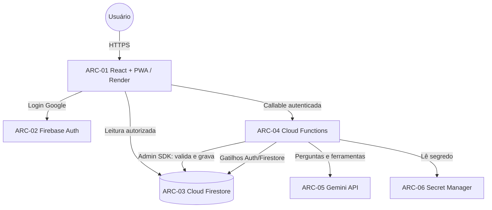

# Visão geral da arquitetura

**Projeto:** Sistema de Gestão e Consulta de Horários Escolares
**Versão:** 1.0 (decisões de desbloqueio do Back-End)
**Data:** 03/11/2026
**Responsável:** Arquiteto
**Status:** decisões registradas; implementação liberada para os módulos cobertos por ADR-01 a ADR-07.

---

## 1. Fonte de verdade

| Assunto | Documento canônico |
|---|---|
| Requisitos | `Plano/requisitos/Plano_requisitos_Sistema_escolar.md` e `Plano/requisitos/matriz-rastreabilidade.md` |
| Schema e identidade da aula | `docs/arquitetura/modelo-dados-firestore.md` |
| Contratos React ↔ Cloud Functions | `docs/arquitetura/integracoes.md` |
| Padrões técnicos | `docs/arquitetura/padroes-tecnicos.md` |
| Segurança e regras | `docs/arquitetura/seguranca-regras.md` |
| Decisões | `docs/arquitetura/decisoes/ADR-01.md` a `ADR-07.md` |
| Implementação existente | `docs/backend/*` e código em `src/` e `functions/src/` |

> `Plano/arquitetura/modelo-dados-firestore.md` passa a ser **documento histórico**. A seção 4
> (horários das 14 turmas) permanece como fonte dos dados do seed, mas o schema canônico é o
> deste pacote. Ver `ADR-01`.

---

## 2. Componentes

| ID | Componente | Responsabilidade | Fronteira de confiança |
|---|---|---|---|
| ARC-01 | React + TypeScript + PWA no Render | Interface, leitura autorizada, coleta de intenções. | Não é autoridade. |
| ARC-02 | Firebase Authentication (Google) | Identidade do usuário. | Fonte da identidade. |
| ARC-03 | Cloud Firestore | Persistência e leitura direta controlada. | Protegido por regras. |
| ARC-04 | Cloud Functions (v2, callable) | Validação, autorização, conflitos, histórico, massa, notificações e IA. | Autoridade do sistema. |
| ARC-05 | Gemini API | Interpretação de perguntas do assistente. | Apenas via ARC-04. |
| ARC-06 | Secret Manager | Chave da Gemini API. | Nunca no cliente/repositório. |
| ARC-07 | GitHub | Versionamento e revisão. | — |

## 3. Diagrama de contexto

## 4. Fronteiras de confiança

1. **Cliente não é autoridade.** Controles visuais não substituem validação no servidor.
2. **Leitura direta é exceção controlada.** Catálogo, aulas, configuração, notificações e
   favoritos podem ser lidos pelo cliente somente conforme as regras. Histórico, operações,
   outbox e uso do assistente são fechados.
3. **Escritas de domínio são server-side.** Catálogo, aulas, configuração e histórico só são
   gravados por Cloud Functions com Admin SDK. Exceções deliberadas: favoritos e marcação de
   notificação como lida, ambos restritos ao próprio usuário por regra (ADR-05).
4. **Histórico é append-only.** Nem administrador edita ou apaga histórico pelo cliente;
   consulta é callable autorizada (ADR-04).
5. **Identidade é do Firebase Auth.** O perfil em `users/{uid}` é derivado e não concede
   privilégio por si só; a autorização server-side lê `role` do perfil (claims permanecem
   pendentes de decisão própria).

## 5. Estado das decisões

| Lacuna | Decisão | ADR | Status | Desbloqueia |
|---|---|---|---|---|
| LAC-08 | Schema canônico em camelCase e coleções em português (Opção B). | ADR-01 | Aprovada | Índices, CRUD, seed, histórico, notificações. |
| LAC-02 | ID determinístico da aula e horários derivados da configuração. | ADR-02 | Aprovada | Aulas, consultas, conflitos, seed. |
| LAC-05 | Limite de 200 aulas, transação única e outbox. | ADR-03 | Aprovada | Edição em massa. |
| LAC-10/LAC-11 | Histórico único, append-only, leitura por `admin`/`gestor`. | ADR-04 | Aprovada | Auditoria e consulta. |
| LAC-13 | Notificações com TTL de 180 dias e favoritos por usuário. | ADR-05 | Aprovada | RF09, RF43–RF47. |
| LAC-16 | Ciclo ativo → arquivado → excluído, com bloqueio por aulas ativas. | ADR-06 | Aprovada | Exclusão segura. |
| LAC-07 | Ferramentas allowlist, cotas e logs mínimos do assistente. | ADR-07 | Aprovada | RF10. |

## 6. Lacunas que continuam abertas (não bloqueiam o primeiro CRUD/seed)

| Lacuna | Efeito |
|---|---|
| LAC-03 / RF58 | Concessão/revogação de `admin` ainda sem contrato final. |
| LAC-09 | Gestão de usuários por administrador não definida. |
| LAC-14 | Calendário escolar não existe; a exclusão usa “aulas ativas”, não “futuras”. |
| LAC-15 | Slot vago: ausência de documento é o padrão; “vaga reservada” não foi decidida. |
| LAC-20 | Restrição de domínio Google e rate limit de login não decididos. |
| LAC-21 | Fuso `America/Sao_Paulo` assumido no assistente, pendente de confirmação. |
| LAC-23/LAC-24 | Entidade sala e extensão formal dos RFs continuam pendentes; `salas` fechada. |
| JDK 21 | Testes de regras do Firestore continuam bloqueados no ambiente atual. |

## 7. Fora de escopo desta entrega

- Implementar código, funções, regras, índices ou seed.
- Alterar requisitos funcionais (RF) ou aprovar RF54–RF58.
- Definir autenticação por claims, gestão de usuários ou calendário escolar.
