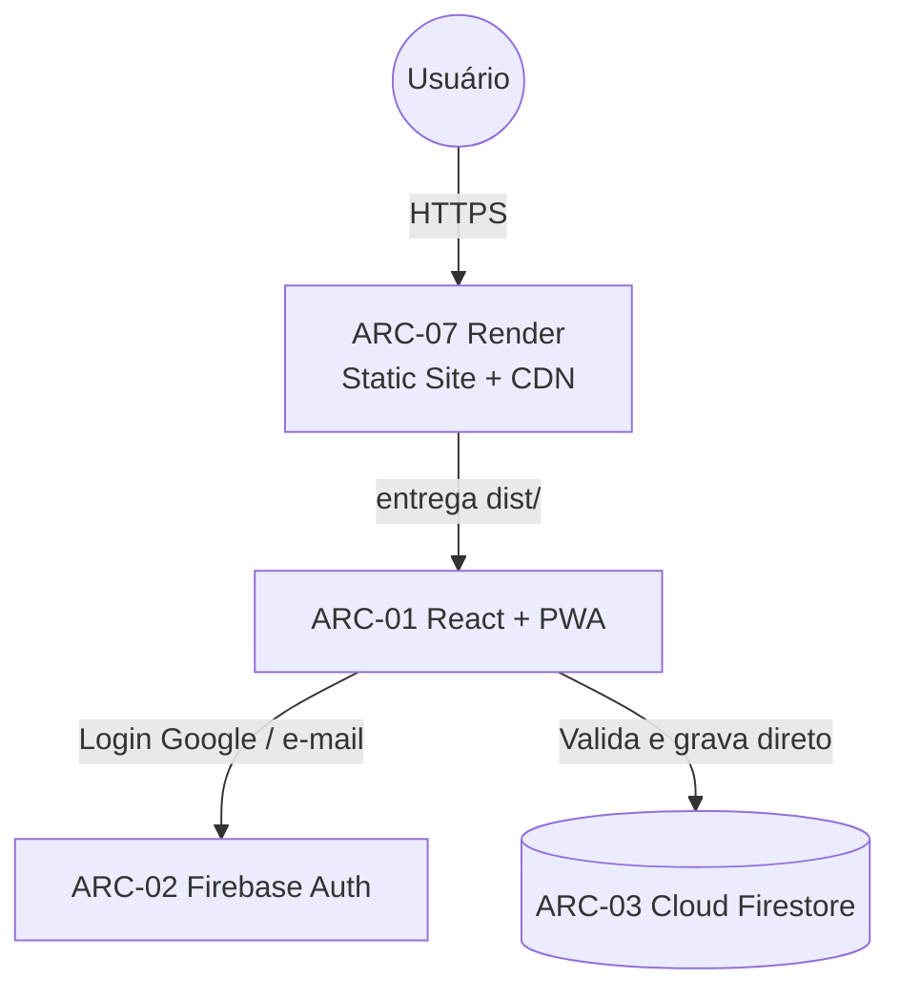

# Visão geral da arquitetura

**Projeto:** Sistema de Gestão e Consulta de Horários Escolares
**Versão:** 2.1 (Client-Only + deploy no Render)
**Data:** 07/11/2026
**Responsável:** Arquiteto
**Status:** modelo Client-Only mantido; canal de entrega especificado em ADR-08 (proposta) e
`docs/arquitetura/deploy-render.md`.

---

## 1. Fonte de verdade

| Assunto | Documento canônico |
|---|---|
| Requisitos | `Plano/requisitos/Plano_requisitos_Sistema_escolar.md` |
| Schema da aula | `docs/arquitetura/modelo-dados-firestore.md` |
| Padrões técnicos | `docs/arquitetura/padroes-tecnicos.md` |
| Segurança e regras | `docs/arquitetura/seguranca-regras.md` |
| Transição Client-Only | `docs/arquitetura/guia-refatoracao-client-side.md` |
| Deploy no Render | `docs/arquitetura/deploy-render.md` |
| Decisão de hospedagem | `docs/arquitetura/decisoes/ADR-08.md` |

---

## 2. Componentes

| ID | Componente | Responsabilidade | Fronteira de confiança |
|---|---|---|---|
| ARC-01 | React + TypeScript + PWA | Interface, validações de negócio, acesso direto ao banco. | **Autoridade de fato no modelo Client-Only atual**; ver RISCO-32. |
| ARC-02 | Firebase Authentication | Identidade do usuário (Google e e-mail/senha). | Fonte da identidade. |
| ARC-03 | Cloud Firestore | Persistência, leitura e escrita diretas. | Protegido por regras estáticas. |
| ARC-07 | Render Static Site + CDN | Build, hospedagem do `dist/`, TLS, CDN, rewrite e cabeçalhos. | Infraestrutura de entrega; **não executa lógica nem autoriza**. |

**Nota sobre ARC-04 a ARC-06:** Cloud Functions, Gemini e Secret Manager pertencem ao
modelo server-side histórico (ADR-01 a ADR-07) e **não fazem parte do deploy atual**. Se
forem reintroduzidos, serão publicados pelo Firebase CLI, nunca pelo Render.

---

## 3. Diagrama de contexto

---

## 4. Fronteiras de confiança

1. **Cliente é a autoridade de fato.** Todo controle de integridade é feito no React e
   validado pelas `firestore.rules`.
2. **Leitura/escrita direta é o padrão.** Não há camada de abstração via funções.
3. **Segurança via regras estáticas.** A proteção contra acesso indevido depende das regras
   do Firestore, que validam perfis lendo `users/{uid}.role`.
4. **Integridade via batch/transação.** Operações multi-documento usam `writeBatch` ou
   `runTransaction` no front-end.
5. **Render não é fronteira de autorização.** O Static Site entrega apenas conteúdo
   público; não há sessão, cookie de servidor ou API própria no Render.
6. **Configuração pública não é segredo.** `VITE_FIREBASE_*` é embutida no bundle. A
   segurança depende das regras e dos domínios autorizados, não do sigilo da API key.
7. **Regras e índices têm release próprio.** O deploy do Render não publica
   `firestore.rules` nem `firestore.indexes.json`.

---

## 5. Deploy e operação

| Item | Decisão |
|---|---|
| Tipo no Render | Static Site (`runtime: static`), sem Web Service. |
| Build | `npm ci && npm run build`. |
| Publicação | `dist/`. |
| Variáveis | `VITE_DATA_MODE=firebase` + configuração pública do Firebase, em tempo de build. |
| Roteamento | Hash routing; rewrite `/* → /index.html` como defesa em profundidade. |
| Autenticação | Domínio `*.onrender.com` e customizado autorizados no Firebase Auth. |
| Firestore | Regras e índices publicados pelo Firebase CLI, em etapa separada. |
| PWA | `sw.js` servido com `no-cache`; cache apenas de shell estático. |
| Rollback | Histórico de deploys do Render ou `git revert`. |

Detalhes operacionais, checklist e troubleshooting: `docs/arquitetura/deploy-render.md`.

---

## 6. Riscos e lacunas abertas

| ID | Item | Situação |
|---|---|---|
| RISCO-23 | Regras sem teste automatizado (JDK 21). | Aberto; revisão manual antes de publicar. |
| RISCO-24 | Produção em modo demo por env ausente. | Mitigado por checklist; falha de build recomendada. |
| RISCO-25 | Login quebrado por domínio não autorizado. | Mitigado pela configuração do Firebase Auth. |
| RISCO-26 | PWA/CDN com versão antiga. | Mitigado por `no-cache`; versionamento do SW recomendado. |
| RISCO-31 | Acesso público amplo (LAC-20). | **Aberto**; decisão de negócio pendente. |
| RISCO-32 | Modelo Client-Only sem autoridade server-side. | **Herdado**; ver `guia-refatoracao-client-side.md`. |

LAC-20 (restrição de domínio de login) e LAC-21 (fuso) continuam abertas. A publicação da
URL não deve ser tratada como decisão de escopo de acesso.
